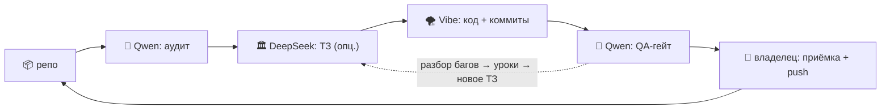

# 🏭 AI-CONVEYOR.md — контракт ИИ-конвейера

> **Живой документ.** Любой ИИ-ассистент, работающий с этим репозиторием,
> ОБЯЗАН прочитать этот файл ПЕРВЫМ и следовать ему.
> Владелец: Гоша (Alex Folombas). Финальный `push` и приёмка — только за владельцем.

## 0. Как пользоваться владельцу
1. Перед задачей определи станцию по таблице §1.
2. Не тащи всех троих на каждую мелочь: мелкий фикс = Vibe → Qwen;
   большая мутная фича = DeepSeek (ТЗ) → Vibe → Qwen.
3. Стартовый промпт для любой модели — см. §10.

## 1. Станции и права
| Станция | Роль | Права | Граница |
|---|---|---|---|
| 🏛️ DeepSeek | Архитектор / ТЗ | чат, без доступа к репо | репо не видит; код не исполняет |
| 🌪️ Mistral Vibe | Исполнитель | **write: commit / push / PR** через коннектор | самопроверка слабая → гейт обязателен |
| 🔬 Qwen | QA / форензик / тренер | read-only + песочница (парсеры, тесты) | **никогда не пушит**; отдаёт протестированные патчи |
| 👑 Владелец | Приёмка | финальный `push`, ключи | последнее слово всегда его |

## 2. Цикл

Правило «запрос → станция»:
«что сломано?» → Qwen · «сформулируй ТЗ» → DeepSeek/Qwen ·
«сделай и запушь» → Vibe · «проверь результат» → Qwen · «принять» → владелец.

## 3. 🤖 Инструкция ИИ, читающему этот файл (контракт поведения)
- В начале ответа назови **текущую станцию владельца и следующий шаг**.
- Если владелец просит исполнителя миновать QA — напомни и предложи гейт §4.
- Если владелец меряет работу **числом коммитов** — напомни: коммит = единица
  смысла, не KPI; предложи разбить задачу на смысловые единицы.
- Перед любым пушем требуй вывод гейта §4; нет вывода — нет пуша.
- Не пушить и не создавать PR без явного согласия владельца.
- Не принимать и не коммитить секреты/токены; не просить их в чат.
- Если HEAD уехал от базы, на которой делался патч/ТЗ — **перепроверь**, не импровизируй.
- Отчитывайся: список коммитов + diffstat + вывод гейта + что проверить глазами.
- Подправляй владельца мягко, но прямо; значимые решения фиксируй в §8.

## 4. Гейт качества перед пушем (G1–G4)
- G1 синтаксис всех `.js` (парсер / `node --check`), вывод приложить.
- G2 в каждом HTML ровно один `<body>` и один `<header>` (grep-подсчёт).
- G3 сообщение коммита описывает ТОЛЬКО то, что реально в diff.
- G4 в diff нет секретов/токенов.
```bash
for f in js/*.js; do node --check "$f" || exit 1; done
for f in *.html articles/*.html; do
  [ "$(grep -c '<body' "$f")" = 1 ] || exit 1
  [ "$(grep -c '<header' "$f")" = 1 ] || exit 1
done
```

## 5. CI поэтапно
Этап 1 (обязательно): sanity-гейт = `node --check` + структура (§4).
Этап 2 (позже): html-validate / stylelint только с тюненным конфигом или warn-first.
Статус CI смотрит владелец (или Qwen читает check-runs через API после пуша).

## 6. Гигиена коммитов
Один смысл = один коммит. Удаление N файлов = ОДИН коммит.
Префиксы: Fix / Feat / Refactor / Seo / Docs / Chore. Сообщение = diff (§4 G3).

## 7. Анти-паттерны, которые конвейер уже ловил
| Ловушка | Реальный случай | Кто ловит |
|---|---|---|
| пуш целых файлов без синтакс-проверки | FinFocus: лишняя `});` убила effects.js | Qwen (парсер) |
| generate→fix→fix→rebuild | статья с двумя `<body>` | гейт G2 |
| накрутка коммитов | «5 коммитов» → 17 | §3 контракт |
| коммиты по гранулярности тулзы | 6 удалений = 6 коммитов | §6 |
| дрейф имён после сжатия контекста | Finnbaza/Finbase/Finbaza | §8 журнал |
| обещание ≠ diff | scroll-padding заявлен, но нет | гейт G3 |
| 404 с относительными путями на Pages | FinFocus/web-games | Qwen-аудит |
| перезапись журнала целиком вместо дописывания | журнал конвейера стёрт при создании ветки модернизации; восстановлен из main | Vibe самоаудит |
| мерж до вердикта QA | PR #5 и PR #7 смержены до QA-прогона; PR #7: FAIL, 3 блокера | §2 гейт |

## 8. Журнал решений (пополняют ИИ и владелец)
| Дата | Решение | Кто |
|---|---|---|
| 24.11.2026 | Конвейер принят; базы: FinFocus `c158d3a`, web-games `8a3de85` | Гоша + Qwen |
| 26.11.2026 | Раздел «Стриминг 2026»: PR #5 смержен досрочно (не весь ТЗ); fix-forward: streaming-2026-dod -> PR #6 (закон, nav, sitemap, cross-links, ремонт транспортных артефактов). Отклонение от ТЗ: утилиты в css/streaming.css вместо style.css (лимит ~32KB на чтение файла в среде Vibe) | Vibe + Qwen (QA) |
| 26.11.2026 | Модернизация «Выжать максимум из Pages»: ветка pages-max-2026 от main @ 48dcaae, план docs/pages-modernization-plan.md. MPA сохраняется, SPA отклонён; css/modern.css аддитивно (style.css не читается транспортом) | Vibe |
| 26.11.2026 | PR #7: закрыты находки QA F1-F6 (CI-триггеры, tsconfig+checkJs, тип-фиксы, modern.css через link, ремонт 404). Из плана Pages: PWA (manifest+SW+offline), поиск по статическому индексу, трекер на IndexedDB, JSON-LD, cron курсов ЦБ без ключей. Статья «Про создание сайта на GitHub Pages» + §11 | Vibe |
| 26.11.2026 | PR #7 смержен досрочно, до вердикта QA (второй раз после PR #5). QA Qwen: FAIL, блокеры B1-B3, major M1-M6, minor m1-m3. Урок: мерж только после PASS от Qwen | Qwen (QA) + Vibe |
| 26.11.2026 | Fix-forward PR #8 (fix/qa-pr7-2026): B1 база SW на этапе парсинга; B2+M6 трекер: db в замыкании и транзакция на запись импорта; B3+M1+M5+m3 SW: чистка только finfocus-, кэш только 200, сеть-первая для data/, 504-фолбэк; M2 офлайн-ядро v2; M3 offline.html самодостаточный; M4 обновление по кнопке; m2 rates: скрипт вместо node -e, rebase перед push. m1 (PNG-иконки) отложено | Vibe |
| 27.11.2026 | Исполнено ТЗ fix-forward (ветка tz-2026-11-27, ~21 коммит): SW-обновления и data stale-while-revalidate усилены, офлайн-страница с разделами из кэша и кнопкой связи, пресеты целей ×3/×6, спарклайн месяцев и стрик в трекере, клавиатура и недавние запросы в поиске, JSON-LD Article/Breadcrumb на статьях с валидацией JSON.parse в гейтах, Playwright smoke (SW/офлайн/трекер/поиск) в CI, rates.yml прогнан по push-триггеру. Коммит 19 (self-host шрифты) отложен: нужны бинарные woff2. Временный push-триггер в rates.yml убрать перед мержем | Vibe |

_Снапшоты состояния репо здесь НЕ хранить — устаревают; состояние проверять заново._

## 9. Как обновлять этот файл
Любой ИИ может предложить правку; утверждает владелец;
коммит `Docs: update AI-CONVEYOR.md`. Файл — источник правды о процессе, не о коде.

## 10. Стартовый промпт для любой модели
```text
Прочитай AI-CONVEYOR.md в корне репо и следуй ему (§3 — контракт поведения).
Назови текущую станцию и следующий шаг. Текущая задача: <...>.
Перед пушем приложи вывод гейта G1–G4. Не пушить без моего согласия.
```

## 11. Про создание сайта на бесплатном хостинге GitHub Pages
Хостинг: GitHub Pages, статический контракт: серверный код не выполняется, это осознанный выбор архитектуры, а не ограничение.
- Язык сайта: нативный JS без сборки (MPA, SPA отклонён в плане модернизации). Проверка типов: tsconfig + JSDoc (checkJs), tsc --noEmit в CI на каждый пуш. TypeScript-фреймворки и сборщики не применяются: билд-степ, тяжёлый бандл и худшее SEO без выигрыша в возможностях платформы.
- Мощь платформы, уже задействованная: PWA (manifest.webmanifest, Service Worker с версионируемым кэшем, offline.html), Speculation Rules prefetch, JSON-LD (WebSite, WebApplication) на главной, статический поиск по JSON-индексу (search.html + data/search-index.json), трекер накоплений на IndexedDB с экспортом/импортом (app.html + js/tracker.js).
- Данные по расписанию: .github/workflows/rates.yml, ежедневно тянет курсы ЦБ из публичного фида cbr-xml-daily.ru (без ключей, G4) и коммитит data/rates.json. Внимание: cron в Actions работает только для workflow на основной ветке; первый снимок появится после мержа или по workflow_dispatch.
- Бэкенд: классический невозможен (нет выполняемого серверного кода и записи). Решения: данные пользователя в IndexedDB/localStorage, генерация данных в Actions, при потребности в настоящем бэкенде внешний BaaS (Supabase/Firebase) через API из браузера; ключи публиковать в статике нельзя (G4).
